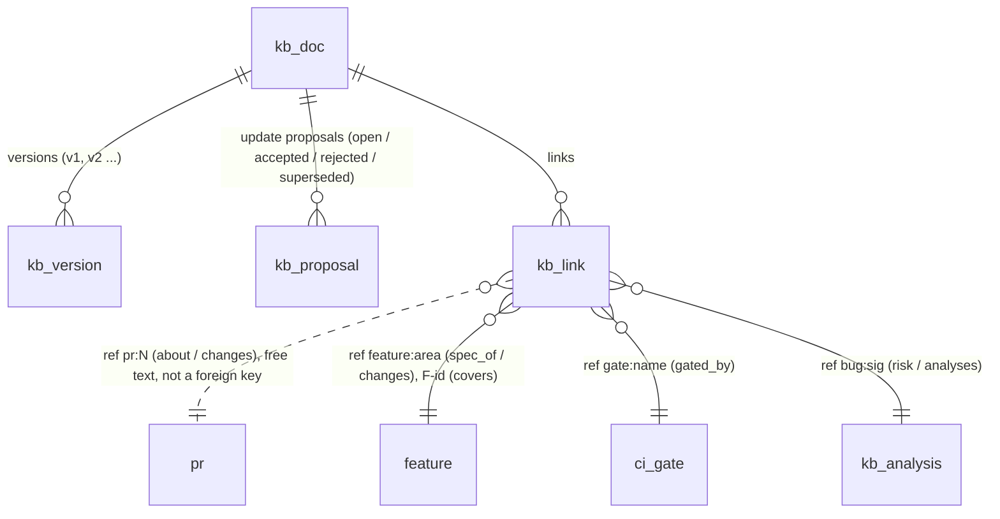

# ops-app data model (ERD)

One SQLite file (`data/ops.db`) holds the release and CI history. Schema: [`backend/schema.sql`](../backend/schema.sql).

## Design rules

| Rule | Why |
|---|---|
| Every fact keeps its natural key (tag, run id, job id, PR number, pipeline + build number) | Re-running a collector updates rows; history is never duplicated |
| Things that change over time are stored per snapshot or per day (`release_verdict`, `pr_state`, `kpi_daily`) | We can answer "what did we know on day X?" and draw trends |
| Every row points to the `snapshot` that last wrote it | Provenance: which run, which file, when |
| "What should ship" (`artifact_spec`) is separate from "what we saw" (`artifact`) | A red CI run is not the same as a missing artifact. The 0.5.8rc1 run was red, but the RC image was on Docker Hub |
| Analysis lives in SQL views (`v_*`) | The page and ad-hoc queries use the same definitions |
| No network in the page. Collectors run locally | Matches the local-only rule for the Ops page |

## Diagram

```mermaid
erDiagram
    snapshot ||--o{ release : "last wrote"
    release_line ||--o{ release : has
    release_line ||--o{ decision : "needs (D1..)"
    release_line ||--o{ blocker : "blocked by (C1.., #pr, ci)"
    release ||--o{ artifact : "seen in registry"
    artifact_spec ||--o{ artifact : "expected as"
    release ||--o{ wf_run : "publish runs (head_branch = tag)"
    workflow ||--o{ wf_run : runs
    wf_run ||--o{ wf_job : has
    release ||--o{ pr_release : contains
    pr ||--o| pr_release : "ships in"
    pr ||--o{ pr_feature : changes
    feature ||--o{ pr_feature : "changed by"
    pr ||--o{ pr_label : has
    pr ||--o{ pr_state : "open state per snapshot"
    bk_pipeline ||--o{ bk_build : has
    pr ||--o{ bk_build : "PR builds (pr = number)"
    bk_build ||--o| weekly_run : "weekly full suite verdict"
    release ||--o{ release_verdict : "verdict per snapshot"
    snapshot ||--o{ release_verdict : at
    snapshot ||--o{ pr_state : at

    release { text tag PK; text line FK; text kind "rc|final|post"; int seq; int sort_key; text sha; text published_at }
    artifact_spec { text code PK; text channel "pypi|gh|docker"; text package; int for_rc; int for_final }
    artifact { text release_tag PK; text spec_code PK; int present; int ok; text ref; text detail; text checked_at }
    wf_run { int run_id PK; int workflow_id FK; text event; text head_branch; text release_tag FK; text conclusion; int attempt }
    wf_job { int job_id PK; int run_id FK; text name; text conclusion; text error_line }
    bk_build { text pipeline PK; int number PK; text state; text branch; int pr; real wait_min }
    weekly_run { text pipeline PK; int number PK; text kind; text verdict; int required; int failed; int missing; int skipped }
    pr { int number PK; text title; text author; text created_at; text merged_at; text state }
    decision { text id PK; text line FK; text code; text question; text status; text choice }
    blocker { text id PK; text line FK; text kind "carryover|pr|ci|publish|artifact"; text status; text evidence }
    kpi_daily { text day PK; text key PK; real value; text source }
```

## Tables

| Table | One row = | Key | Filled by |
|---|---|---|---|
| `snapshot` | one ingest batch | id | every collector |
| `release_line` | a version line, e.g. `0.5.8` | line | derived from tags |
| `release` | one main tag (`v0.5.8rc1`, `v0.5.7`, `v0.5.7.post1`). Platform tags (`-xpu`) are artifacts, not releases | tag | GitHub releases, entity graph |
| `artifact_spec` | one thing a release should ship, and for which tag kind | code | `config.py` |
| `artifact` | what we found in PyPI / GitHub / Docker Hub for one tag | tag + spec | `collect_release.py` |
| `workflow`, `wf_run`, `wf_job` | GitHub Actions runs and jobs. A failed job stores its first error line | run id, job id | GitHub API, old snapshots |
| `bk_pipeline`, `bk_build` | Buildkite builds (dev and PR) | pipeline + number | old snapshots, report cache |
| `weekly_run` | Weekly full-suite verdict per build (`kind` weekly / reference) | pipeline + number | `collect_weekly.py` (Buildkite meta-data `weekly-verdict`) |
| `pr`, `pr_label`, `pr_feature` | pull requests, labels, changed feature areas | number | GitHub, entity graph |
| `pr_release` | the first release that contains a PR | pr + tag | entity graph (git first-parent log) |
| `pr_state` | review / mergeable / CI state of an open PR at a snapshot | snapshot + pr | GraphQL PR list |
| `decision` | a release decision (D1–D4) | `line:code` | `release-<line>/RELEASE_PREP.md` |
| `blocker` | something that blocks the line: carry-over (C1–C6), PR bug, dev CI red | id | prep doc, Trace Agent, Buildkite |
| `release_verdict` | the verdict for a tag at a snapshot | snapshot + tag | `model.record_verdicts` |
| `kpi_daily` | one daily metric value (long format: day, key, value) | day + key | `observe_history/`, `ops_hist/` |

## Views (ready for analysis)

| View | Answers |
|---|---|
| `v_release_cycle` | Days from the first RC to final, number of RCs and posts, per line |
| `v_artifact_matrix` | Expected vs found, per tag and artifact |
| `v_publish_weekly` | publish.yml runs per week and event: ok / failed / cancelled |
| `v_dev_pipeline_daily` | dev pass rate per pipeline per day |
| `v_failing_jobs` | Jobs that fail most, with the last error line |

Example queries:

```sql
-- Which artifacts failed most often over all releases?
SELECT label, SUM(expected AND NOT ok) AS times_missing FROM v_artifact_matrix GROUP BY label ORDER BY 2 DESC;
-- How long was dev red on a gate pipeline before each RC?
SELECT r.tag, b.pipeline, MAX(b.created_at) AS last_red FROM release r JOIN bk_build b
  ON b.branch='dev' AND b.state='failed' AND b.created_at < r.published_at GROUP BY r.tag, b.pipeline;
-- Did a verdict change over time?
SELECT s.taken_at, v.verdict FROM release_verdict v JOIN snapshot s ON s.id=v.snapshot_id WHERE v.release_tag='v0.5.8rc1';
```

## Living knowledge base (PR Inspector, 2026-11-24)

RFC (one per PR) and FRS (one per code area / feature) are generated from the PR Inspector data by `backend/kb.py`
(`python -X utf8 kb.py build`, also run by `build_pr_inspector.py` in the page build). A version is never overwritten:
new facts create a proposal; a person decides it.



| Table | One row = | Key | Filled by |
|---|---|---|---|
| `kb_doc` | one RFC (`rfc:6572`) or FRS (`frs:smcore`); its current version, status (draft, reviewed) and `last_seen` (last build whose input still had the subject; older = "frozen") | doc_id | `kb.py build` |
| `kb_version` | one version: markdown, the facts it was made from (JSON + hash, `facts_made`), author (generator / human), reason, `proposal_id` (accepted proposal), `decided_by`. Append-only: triggers refuse UPDATE / DELETE | doc_id + version | `kb.py build` (v1), `kb.py accept`, `kb.py edit` |
| `kb_link` | one link from a document to a PR, feature, F-id, CI gate or bug signature (`ref` is free text such as `pr:6572`, not a foreign key) | doc_id + ref + rel | `kb.py build` |
| `kb_proposal` | one proposed update: base version, triggers (comma separated: ci_change, gate_change, test_change, pr_overlap, pr_change, feature_change), changed facts, diff, new text, `source` (build / simulate), `input_made`, `decided_by`, `decision_reason`, `superseded_by` | proposal_id | `kb.py build` when the facts hash changed |
| `kb_analysis` | one bug / error analysis: failure signature -> suspect PRs, commits, features, functions | ref | `kb.py build` (backward direction of the Inspector) |
| `v_kb_open_proposals` (view) | open proposals with their document | | |

| Rule | How |
|---|---|
| Never overwrite silently | Same facts (list order ignored) -> nothing, and open proposals of that document are closed as `superseded`. New facts -> a proposal on the current version (older open ones of the same source become `superseded`). New versions come only from `accept` (generator text) or `edit` (human text). A proposal whose base is no longer the current version is closed as `superseded` |
| Decisions are audited | `accept` / `reject --by <who> --reason <why>` (default `$OPS_KB_REVIEWER`); one decision at a time (`BEGIN IMMEDIATE`, `WHERE status='open'`) |
| Simulations stay simulations | `--simulate` needs `--db <copy>` (or `--allow-real-db`); its proposals are `source='simulate'` and `accept` refuses them without `--allow-simulated` |
| Keep human text | Sections titled "(edit)" and any section a person added are copied from the current version into every proposal. `edit` refuses changes to generated sections (they would be lost) unless `--force`, and refuses an empty file |
| CI or feature changed | FRS facts include the gate pipeline steps and conditions (`.buildkite/k3_tests/*/pipeline.yml` at the clone HEAD), tiers, tests, flaky workloads, bugs and open PRs. A pipeline edit -> trigger `ci_change` for every FRS gated by it |
| Try it without real changes | `kb.py build --simulate sim.json` (see the docstring); `tests/check_kb.py` does it on a copy of the DB |

## CI impact by version (2026-11-26)

Filled by `backend/collect_ci_impact.py`, computed by `backend/ci_impact.py`, read by `model.ci_impact()` (`/api/impact`, `dist/api/impact.json`, `release_desk.json` `impact`, tab `#obs/impact`). Versions are declared in `backend/ci_versions.json`: v0 = Report 1130 baseline; v1 = #6730 + #6731 + #6854; add v2, v3 ... there.

| Table | Key | Holds |
|---|---|---|
| `ci_impact_version` | `id` | v0 .. vN: title (EN, VI), PRs, window `since` / `until`, `days`. A version starts `burn_in_hours` (24) after the last merge of its start PRs and ends where the next one starts |
| `ci_impact_def` | `key` | One metric: `family` (gpu / mp / gha / rel), EN + VI label, unit, `better` (down / up / info), `min_n`, `after_only`, `headline` (position in the KPI row, 0 = none) |
| `ci_impact_value` | `key`, `version` | Value of a metric in a version: `value`, `n` (sample), `status` (baseline / ok / collecting / insufficient / new / no_data), `d_base` / `d_base_pct` (vs v0), `d_prev` / `d_prev_pct` (vs the previous version), `note` (JSON [en, vi]) |
| `ci_impact_meta` | `key` | JSON: cutoffs (merge time + sha per PR), heavy-tier `decisions` and `heavy_reasons` per version, `weekly`, `coverage` (GitHub runs matched to a PR, unmapped GPU minutes), `burn_in_hours`, `min_days` (14), `scope`, `collected_at` |

v0 = the live window of `baseline_days` (default 30) before the first start-PR merge of v1; v0 and v1.. all come from one live fetch on every refresh (Buildkite builds cached per build in `data/ci_impact_cache/bk_builds.json`, finished builds older than 3 days are not asked again), normalized to the P1 table columns (`jobs_before.csv` / `jobs_after.csv`, `gh_jobs_before.csv` / `gh_jobs_after.csv`) and cut per window (2026-11-26: the frozen Report 1130 tables are no longer used). Sample rules (methodology review 2026-11-26): p50 needs N >= 100, p90 N >= 300, rates N >= 200; a window under 14 days is `collecting`; below `min_n` no value is shown (`insufficient`). Never extrapolated. `ci_impact_metric` (first version of this tab) is emptied and unused.

## Not modeled yet (phase 2)

| Entity | Source today | Value |
|---|---|---|
| `test`, `build_test` (build runs test) | `entities.json` edges `runs`, `runs_suite` | Which tests each release really ran |
| `fail_signature`, `build_fail` | `P1/raw/fail_signatures.json` | Flaky vs real failures per release |
| `sprint`, `sprint_pr` | `ROADMAP.md` | Planned vs shipped per sprint |
| Buildkite jobs (per job wait and duration) | `bk.recent` | Queue cost per pipeline over time |
