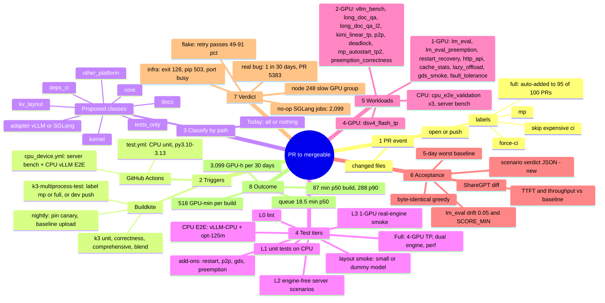
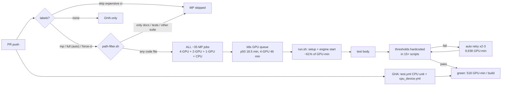
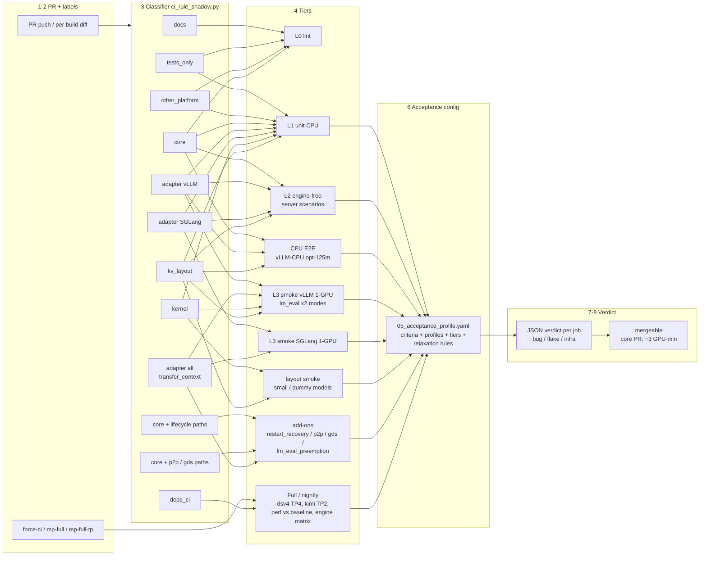

# 06 — Mindmap: PR → CI layers

How a PR reaches "mergeable", layer by layer: today vs proposed. Numbers come from P1–P8 (30 days, 2026-10-05 → 11-04).
**Polished visual (recommended):** [06_PR_TO_CI_VISUAL.html](06_PR_TO_CI_VISUAL.html). Raw Mermaid diagrams: [06_PR_TO_CI_MINDMAP.html](06_PR_TO_CI_MINDMAP.html) or a VS Code Mermaid preview.

## Layers at a glance

| # | Layer | Question it answers | Source |
|---|---|---|---|
| 1 | PR event | What changed, who pushed, which labels? | GitHub |
| 2 | Trigger + labels | Does CI start at all? | `BK_WEB_SETUP.md:6`, `helpers.sh:53-71`, `automerge-labeler.yml:14-17` |
| 3 | Path filter / classifier | Which change class is this PR? | today `path-filter.sh`; proposed [P8 ci_rule_shadow.py](outputs/P8/ci_rule_shadow.py) |
| 4 | Test tier | Which test layers are required for this class? | [03](03_APPROACH_AND_PLAN.md), [P8 §3](outputs/P8/shadow_report.md) |
| 5 | Workload / job | Which concrete jobs run, on what hardware? | `pipeline.yml`, [P1](outputs/P1/cost_by_workload.csv) |
| 6 | Acceptance criteria | What does PASS mean for each job? | [05 YAML](05_acceptance_profile.draft.yaml), [P7](outputs/P7/criteria_inventory.md) |
| 7 | Verdict + retry | Is a red job a real bug, flake or infra? | [P1](outputs/P1/), [P2](outputs/P2/coverage_map.md), [P5](outputs/P5/baseline_decisions.md) |
| 8 | Mergeable | Time-to-green, GPU-min per PR | Observability direction (parent PDF) |

---

## 1. Mindmap (whole picture)

---

## 2. Today: how a PR flows (all-or-nothing)

---

## 3. Proposed: class → tier → workload → acceptance

---

## 4. Workload → future home (from P2, P4, P5, P6, P8)

```mermaid
flowchart TB
  subgraph NOW[Today: every code PR]
    W1[cache_stats 98% startup]
    W2[http_api 97%]
    W3[lazy_offload 97%]
    W4[gds_smoke 96%]
    W5[restart_recovery]
    W6[deadlock]
    W7[long_doc_qa_l2 24% flaky]
    W8[long_doc_qa]
    W9[vllm_bench]
    W10[preemption_correctness 19.9% GPU]
    W11[dsv4_flash_tp 4-GPU]
    W12[kimi_linear_tp]
    W13[lm_eval]
    W14[fault_tolerance]
    W15[p2p]
    W16[mp_autostart_tp2]
  end

  subgraph NEW[Future home]
    U[L1 connector unit test]
    SB[L2 server scenario]
    STORED[1-GPU + stored baseline]
    REPLAY[same-engine replay on PR,<br/>full on nightly]
    LSM[layout smoke 1-GPU]
    SMK[L3 smoke]
    ADD[add-on by path]
    NIGHT[nightly / label]
  end

  W1 --> U
  W2 --> SB
  W3 --> SB
  W4 --> ADD
  W5 --> ADD
  W5 -. server side .-> SB
  W6 --> SB
  W7 -- data flow --> SB
  W7 -- perf --> STORED
  W8 --> STORED
  W9 --> STORED
  W10 --> REPLAY
  W11 --> LSM
  W11 --> NIGHT
  W12 --> LSM
  W13 --> SMK
  W14 --> NIGHT
  W15 --> ADD
  W16 --> NIGHT
```

---

## 5. Where each finding plugs in

| Layer | Finding | Action | Source |
|---|---|---|---|
| 1 Labels | `full` label auto-added to 95/100 PRs → not a real signal | Use `force-ci` / new `mp-full` | P8 §1 |
| 3 Classifier | MP is all-or-nothing today | Path classes → tiers; saves ~80% PR GPU-min, 0 missed catches | P8 |
| 4 Tiers | ~61% of GPU-min is setup + engine start | Move server-level checks to L2 (no engine) | P1, P4 |
| 4 Tiers | XPU already runs 1-device HMA layout smoke | Port to CUDA as layout smoke | P6 |
| 5 Workloads | 2,099 no-op SGLang jobs (~20 min queue each) | Remove from matrix | P1, P2 |
| 5 Workloads | `preemption_correctness` labeled 1-GPU, uses 2-GPU pod | Fix label; replay on PR | P1, P5 |
| 6 Acceptance | 4 defaults for one `SCORE_TOLERANCE`; TTFT check never runs (C9); empty baseline passes (C11) | Central YAML + small fix PRs | P7 |
| 6 Acceptance | `lmcache bench server` exits 0 on failed checks | Fix exit code before using as gate | P4 |
| 7 Verdict | Failures cluster on node 248; SGLang long_doc_qa regression since ~10-27 hidden by retry | Log GPU identity; report regression | P5 |
| 7 Verdict | Only 1 real code catch in 30 days (PR #5383) — and CPU E2E caught it too | Supports cheaper default tiers | P2 |
| — Security | HF_TOKEN plaintext in Buildkite UI config | Ask maintainers to rotate | P1 |
