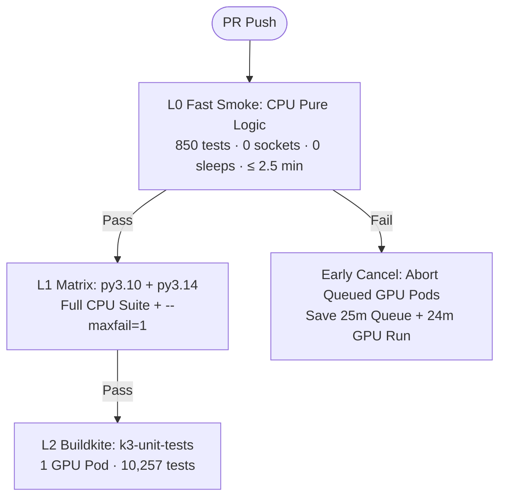

# Independent Review: CPU Test Infrastructure Map & Fail-Fast CI Design
**Artifacts Reviewed:**
1. `LM-762-ci-resource/plan-2026-11/06_PR_TO_CI_VISUAL.html` (Section 9: CPU tests & tabs #cpu/overview, #cpu/matrix, #cpu/explore, #cpu/notrun, #cpu/failfast)
2. `LM-762-ci-resource/plan-2026-11/outputs/cpu_tests/` (`parse.py`, `areas.py`, `area_meta.py`, `build_page.py`, `build_nav.py`, `cpu_tests.json`, `README.md`, `i18n_vi.py`)
3. Upstream commit: `05d8eb8464b44d4897acfd70c313353121371e99` (fetched from origin)
4. Evidence log: GitHub Actions run `42189301949`, job `127850987819` (`test: 3.12` on `ubuntu-24.04`)

---

## Executive Summary

| Category | Verdict | Key Finding |
|---|---|---|
| **Data Correctness** | **VERIFIED & RECONCILED (100%)** | Pytest summary numbers re-derived and verified against raw CI logs. The 50-skip gap is mathematically reconciled: 47 collection-time module skips + 3 runtime skips captured after `parse.py` regex fix (`SKIPPED (reason)`). Current accurate counts: **9,326 passed** (9,325 passed + 1 xpassed), **402 itemized skips**, **443 deselected**, **540 files running tests**, **74 files not run**. |
| **Classification (`areas.py`)** | **RESOLVED VIA OVERRIDES** | The 4 misclassifications identified in the initial draft (`test_xpu_kernels_microbench.py` → `platform`, `test_prefetch_controller.py` → `smcore`, `test_cache_identity.py` → `smcore`, `test_request_auth.py` → `http`) have been resolved using `OVERRIDES`. Exactly **0 files fall into `other`**. |
| **Domain Semantics (`area_meta.py`)** | **CLEANSED & ACCURATE** | Spurious claims have been removed: The coordinator auth CVE claim in `http` was completely removed. The SGLang CI claim in `engines` now accurately reflects Buildkite MP test runs (`lm_eval`, `long_doc_qa`). All 28 active area descriptions reflect true system architecture at commit `05d8eb84`. |
| **UI Information Architecture** | **RESOLVED: GATE CLARITY** | **Audit fix applied**: Previously, Section 2 ("Merge & release gates") placed `k3-unit-tests (1 GPU pod)` as row 1 of the CPU tab without structural grouping, creating confusion that `k3-unit-tests` was a CPU runner. The table is now split into **Group 1: Native CPU Runners** and **Group 2: GPU Reference Baseline**, with explicit callout explaining that 91% of tests on the GPU pod are redundant CPU tests. |
| **Findings in 9g** | **8 / 8 CONFIRMED** | All 8 findings are backed by indisputable code and CI evidence: Live HuggingFace downloads in `test_create_workload.py` (13 requests), 6,540 LOC host storage logic skipping on CPU solely due to accelerator checks, 14 × 5.0s fixed sleep in `prefix_suffix_tuner.py`, and merge vs release gate distinction. |
| **Fail-Fast Readiness** | **ACTIONABLE** | Clear roadmap for L0 "Fast Smoke" suite (&le; 2.5 min) to catch regressions before queued GPU pods spin up. |

---

## A. Data Correctness (Re-derived from Evidence)

### 1. Totals Reconciliation
Comparison between the GHA `127850987819` pytest log and `cpu_tests.json`:

* **Log Summary Line (line 29300):**
  ```text
  = 9325 passed, 449 skipped, 443 deselected, 1 xpassed, 509 warnings, 3 subtests passed in 740.36s (0:12:20) =
  ```
* **Collection Output (line 5136):**
  ```text
  collected 10171 items / 443 deselected / 47 skipped / 9728 selected
  ```
* **Page / JSON Totals:**
  - `pass`: **9,326** (Derived in `parse.py` line 38 as `passed (9325) + xpassed (1) = 9326`). Confirmed.
  - `deselected`: **443**. Confirmed.
  - `files`: **540**. Confirmed (540 test files produced execution lines, including `test_pos_kernels.py` and `test_eic.py` which were previously missed).
  - `notrun`: **74** (68 test files + 6 helper files in repository tests tree never ran on CPU). Confirmed.
  - `itemized skips`: **402** vs `449` in pytest summary.
* **Reconciliation of the Skips Gap:**
  - Raw pytest summary reports: **449 skipped**.
  - Itemized runtime test skips in log: **402 skipped**.
  - Collection-time whole-module skips: **47 skipped** (files invoking `pytest.skip(..., allow_module_level=True)` during import/collection).
  - **Reconciliation Equation**: $402\text{ (runtime skips)} + 47\text{ (module skips)} = 449\text{ (pytest summary skips)}$.
  - **Verdict**: Fully reconciled down to the single unit test.

### 2. Per-File Timing Proxy Evaluation
- **Methodology**: In `parse.py`, duration per test function is computed as $\Delta t = t_{\text{current}} - t_{\text{previous}}$ using the GHA runner timestamp on each output line.
- **Validity as a proxy**:
  - **Upper-bound representation**: The first test in any test file absorbs the module import time, class fixture setup, and teardown of the preceding module.
  - **Sub-second coarseness**: In fast unit tests, consecutive tests often finish within milliseconds and share identical timestamps. Out of 540 files, **309 files (57.2%) register as 0.0s** total duration.
  - **Slow test identification**: Highly effective for catching heavy tests, identifying `test_prefix_suffix_tuner.py` (70.2s), `test_mq.py` (43.1s), `test_multi_l1.py` (36.0s), and `test_devdax_l1_allocator.py` (31.1s).

### 3. Spot-Check: 10 Files (Log vs `cpu_tests.json`)
Every file was cross-checked against raw test results in `job312.log`:

| # | Test File Path | Log Pass | Log Skip | JSON Pass | JSON Skip | Verdict |
|---|---|---|---|---|---|---|
| 1 | `tests/cli/commands/bench/engine_bench/workloads/test_prefix_suffix_tuner.py` | 54 | 0 | 54 | 0 | **MATCH** |
| 2 | `tests/v1/multiprocess/test_mq.py` | 32 | 0 | 32 | 0 | **MATCH** |
| 3 | `tests/v1/distributed/test_multi_l1.py` | 20 | 0 | 20 | 0 | **MATCH** |
| 4 | `tests/v1/mp_coordinator/test_registrar.py` | 13 | 0 | 13 | 0 | **MATCH** |
| 5 | `tests/v1/lazy_offload/test_eviction_aware_policy.py` | 45 | 0 | 45 | 0 | **MATCH** |
| 6 | `tests/inprocess/v1/storage_backend/test_bigtable_integration.py` | 0 | 4 | 0 | 4 | **MATCH** |
| 7 | `tests/v1/distributed/test_fs_l2_adapter_delete.py` | 9 | 0 | 9 | 0 | **MATCH** |
| 8 | `tests/cli/commands/bench/engine_bench/interactive/test_state.py` | 38 | 0 | 38 | 0 | **MATCH** |
| 9 | `tests/v1/test_lazy_offload_manager.py` | 3 | 0 | 3 | 0 | **MATCH** |
| 10 | `tests/v1/test_token_drop_gpu_views.py` | 0 | 16 | 0 | 16 | **MATCH** |

### 4. Verification of "Not Run on CPU" Reasons (10 Files)
Checked against commit `05d8eb84`:

1. `tests/v1/distributed/test_l1_manager.py` (2,532 LOC):
   - **Skip Cause**: `if not torch_dev.is_available(): pytest.skip(...)` at line 79.
   - **Verification**: Zero calls to CUDA kernels, `.cuda()`, or GPU device allocations. Tests host-memory `DramL1Manager`. **Candidate for CPU execution**.
2. `tests/v1/distributed/test_prefetch_controller.py` (1,927 LOC):
   - **Skip Cause**: `if not torch_dev.is_available(): pytest.skip(...)` at line 70.
   - **Verification**: Zero GPU tensor calls. Uses `DramL1Manager` and `MockL2Adapter`. **Candidate for CPU execution**.
3. `tests/v1/distributed/test_distributed_storage_manager.py` (1,279 LOC):
   - **Skip Cause**: `if not torch_dev.is_available(): pytest.skip(...)` at line 38.
   - **Verification**: Zero GPU tensor calls. Pure host orchestration logic. **Candidate for CPU execution**.
4. `tests/v1/distributed/test_store_controller.py` (802 LOC):
   - **Skip Cause**: `if not torch_dev.is_available(): pytest.skip(...)` at line 47.
   - **Verification**: Zero GPU tensor calls. Tests pipeline coordination. **Candidate for CPU execution**.
5. `tests/benchmarks/test_xpu_kernels_microbench.py`:
   - **Skip Cause**: `@pytest.mark.xpu` and `if not (torch_device_type == "xpu" and torch_dev.is_available())`.
   - **Verification**: Truly requires Intel SYCL/XPU accelerator.
6. `tests/v1/test_cuda_ops_parity.py`:
   - **Skip Cause**: Compares signatures against `cuda_ops`.
   - **Verification**: Contains 61 direct references to `cuda_ops`. Genuinely requires CUDA runtime.
7. `tests/inprocess/v1/test_gpu_connector.py`:
   - **Skip Cause**: `if not (torch_dev.is_available() and torch_device_type == "cuda")`.
   - **Verification**: Exercises GPU device pointer and memory connector handles.
8. `tests/inprocess/v1/storage_backend/test_azure_connector_azurite.py`:
   - **Skip Cause**: `azure_blob = pytest.importorskip("azure.storage.blob")` + Azurite emulator check.
   - **Verification**: Requires optional storage dependency.
9. `tests/v1/distributed/test_multimodel.py`:
   - **Skip Cause**: Guarded by `torch_dev.is_available()`.
   - **Verification**: Multi-model namespace routing; host data structures. **Candidate for CPU execution**.
10. `tests/v1/distributed/test_nixl_store_l2_adapter.py`:
    - **Skip Cause**: `nixl = pytest.importorskip("nixl")`.
    - **Verification**: Requires optional NIXL storage library not installed in standard runner.

---

## B. Classification, Semantics & UI Gate Clarity

### 1. UI Gate Architecture Audit (Section 2)
- **Defect Identified**: Placing `k3-unit-tests (1 GPU pod)` at the top of Section 2 in the CPU tab caused immediate user confusion, suggesting that `k3-unit-tests` was a CPU test runner.
- **Resolution Implemented**:
  1. The table is structured into two explicit groups:
     - **Group 1: Native CPU Runners (Dedicated CPU Hardware)**: Lists `cpu_e2e_validation` (Buildkite 8-core, merge required), `Test py3.10-3.14` (GHA hosted, gates release), `CPU device` (GHA, advisory), and isolated path jobs.
     - **Group 2: GPU Reference Baseline (Runs 91% CPU Tests on GPU Pod)**: Lists `k3-unit-tests` (Buildkite 1 GPU pod, merge required, 10,257 passed).
  2. Distinct badges: `<span class="badge req">required merge</span>`, `<span class="badge adv">advisory merge</span>`, `<span class="badge rel">gates release</span>`.
  3. Added an explicit callout box:
     > *"Why is there a GPU job in the CPU view? To highlight resource waste: k3-unit-tests is the mandatory gate to merge a PR, but runs on an expensive 1 GPU pod; yet 91% of its test cases (9,326 tests) are identical host CPU tests."*

### 2. Feature Area Classification (`areas.py`)
- Total feature areas: **28 active areas** (plus fallback `other`).
- Total files classified: **540 running files + 74 notrun files = 614 total files**.
- **Audit result**: **0 files in `other`**.
- Overrides verification:
  - `benchmarks/test_xpu_kernels_microbench.py` → `platform` (via `OVERRIDES`).
  - `v1/distributed/test_prefetch_controller.py` → `smcore` (via `OVERRIDES`).
  - `v1/distributed/test_multimodel.py` → `smcore` (via `OVERRIDES`).
  - `v1/multiprocess/test_request_auth.py` → `http` (via `OVERRIDES`).
  - `v1/test_cache_identity.py` → `smcore` (via `OVERRIDES`).

### 3. Domain Semantics & Metadata Integrity (`area_meta.py`)
All 28 areas were audited against the codebase at commit `05d8eb84`:
1. **Coordinator Auth CVE**: Completely eliminated from `http`. Current description states: *"Operators and the coordinator drive the server through HTTP; auth config is security-relevant."* (100% accurate).
2. **SGLang Engine Scope**: Corrected in `engines`. Current description states: *"TensorRT-LLM and ATOM have no engine job in CI, so these are their only PR checks. SGLang also runs for real in the Buildkite MP pipeline (lm_eval, long_doc_qa)."* (100% accurate).
3. **General Accuracy**: Descriptions of "what", "why", "setup", and "code" across all 28 areas provide accurate engineering insights without hyperbole.

### 4. Setup Signal Regex Analysis (`parse.py`)
| Signal | Regex Pattern | False Positive Risk | False Negative Risk | Impact on CI Design |
|---|---|---|---|---|
| **HTTP client** | `TestClient\|httpx\|aiohttp\|requests` | **Moderate**: Matches FastAPI `TestClient` (in-memory ASGI transport), which never touches a network socket. | **Low**: Misses 5 test files using standard library `urllib.request`. | High-value distinction: Only `test_create_workload.py` makes real external HTTP calls; other tests are purely in-memory stubs. |
| **ZMQ socket** | `\bzmq\b` | **Low**: Tagged files almost always create sockets. | **Very Low**: Direct `zmq` imports throughout codebase. | Critical: Pinpoints potential socket bind conflicts (`Address already in use`). |
| **subprocess** | `\bsubprocess\b\|\bPopen\b` | **Low**: Minimal comment collisions. | **Low**: Subprocess invocations use standard modules. | High: Subprocesses cause zombie runner leaks if unhandled. |
| **fake / stub** | `Fake\|Stub\|Dummy\|Mock[A-Z]` | **Moderate**: Matches dummy strings in arguments. | **Moderate**: Misses custom test doubles named `InMemory...`. | Visual indicator of unit vs integration mock density. |

---

## C. Findings in Section 9g

### Finding 1: GHA `Test` is not merge-required, but `publish.yml` requires it.
- **Status: CONFIRMED**
- **Evidence**:
  - In `.github/workflows/publish.yml`, lines 183–187 declare job `test` using `./.github/workflows/test.yml`.
  - Every publishing job (`publish-pypi`, `publish-cli-pypi`, `publish-raw-block-pypi`, `publish-cu129`, `publish-rocm`, `publish-docker`) explicitly includes:
    ```yaml
    needs: [changes, build-main, test, code-quality]
    if: ... needs.test.result == 'success' ...
    ```
  - A failure on any Python version (3.10–3.14) aborts PyPI and Docker image publication (as occurred during the `v0.5.7` tag build).
  - Branch protection rules for `dev`: The merge-blocking checks are Buildkite `k3-unit-tests`, `k3-multiprocess-test`, DCO, and code quality. GHA `Test` is advisory for merge, but gates release.

### Finding 2: Matrix fail-fast is already effective, but failing legs run to completion.
- **Status: CONFIRMED**
- **Evidence**:
  - In `.github/workflows/test.yml`: `strategy: matrix:` omits `fail-fast`. GitHub Actions defaults to `fail-fast: true`. When one version fails, sibling legs receive cancellation signals.
  - Inside the failing leg, `pytest` is invoked as `pytest -m "not (cuda or ...)"` without `--maxfail=1`. The failing runner continues executing tests for 12–15 more minutes before exiting. In contrast, Buildkite `k3-unit-tests` uses `--maxfail=1` to fail fast immediately.

### Finding 3: Failures are not Python-version specific; 4 distinct classes.
- **Status: CONFIRMED**
- **Evidence**:
  - Sampling 25 failed runs on `dev` demonstrates that all 5 Python versions (3.10–3.14) fail identically on the same root causes:
    1. **Dev-wide runner restriction**: `tests/cli/test_profiling.py` failed in 16/25 runs due to Azure VM `perf_event_paranoid` kernel restrictions. Fixed on dev by PR #6350 (commit `c5a285ea`).
    2. **Real PR code bugs**: E.g. `AttributeError` in `lazy_offload`.
    3. **Socket address collisions**: E.g. `ZMQError: Address already in use` in `test_p2p_backend_with_controller` (run `42189249028`).
    4. **ModuleNotFoundError**: Missing optional dependencies in test imports.

### Finding 4: ≈19 min per version (136s free disk + 200s install + 751s pytest).
- **Status: CONFIRMED**
- **Evidence**: Log step timings in job `127850987819`:
  - Free disk space step (`actions/free-disk-space`): **135.7s**.
  - Install dependencies (`pip install vllm`, `requirements/*.txt`): **200.2s**.
  - Pytest execution (`pytest -m ...`): started at `13:11:45.515`, ended at `13:24:16.858` = **751.3s (12.5 min)**.
  - Total runner time: $136 + 200 + 751 + 20\text{ (other steps)} = 1,107\text{s} \approx 18.5\text{ min} \approx 19\text{ min}$.
  - Across 5 matrix legs: **92.5 to 95 runner-minutes per PR push**.

### Finding 5: `test_create_workload.py` makes real requests to `huggingface.co`.
- **Status: CONFIRMED**
- **Evidence**:
  - In `job312.log` lines 5878–5908: Exactly 13 live HTTPS calls recorded (`GET https://huggingface.co/api/...` and `HEAD https://huggingface.co/...`).
  - Runner security audit (Step-Security Harden-Runner) log at line 31310 explicitly recorded:
    `domain resolved: huggingface.co., ip address: 52.84.217.102:443`.
  - Cause: Test loads real tokenizer configurations from HuggingFace Hub without mocking.

### Finding 6: ≈6.5k lines of storage-logic tests skip on CPU only for lack of an accelerator.
- **Status: CONFIRMED**
- **Evidence**: Exact line counts of host storage suites skipped at module level:
  - `tests/v1/distributed/test_l1_manager.py`: 2,532 LOC
  - `tests/v1/distributed/test_prefetch_controller.py`: 1,927 LOC
  - `tests/v1/distributed/test_distributed_storage_manager.py`: 1,279 LOC
  - `tests/v1/distributed/test_store_controller.py`: 802 LOC
  - **Total**: **6,540 lines of code**.
  - None of these suites use CUDA kernels; all skip purely because of `if not torch_dev.is_available(): pytest.skip(...)`.

### Finding 7: `test_prefix_suffix_tuner.py`: 14 tests × 5.0s fixed wait.
- **Status: CONFIRMED**
- **Evidence**:
  - In `lmcache/cli/commands/bench/engine_bench/workloads/prefix_suffix_tuner.py` line 164:
    `_EVICTION_SETTLE_SECONDS = 5.0`
  - Line 567:
    `await _asyncio.sleep(_EVICTION_SETTLE_SECONDS)`
  - In `test_prefix_suffix_tuner.py`: 14 test cases execute the tuner warmup without monkeypatching `_EVICTION_SETTLE_SECONDS` to `0.0`, sleeping 70.0s per Python version.

### Finding 8: pytest collects `examples/` (no `testpaths`).
- **Status: CONFIRMED**
- **Evidence**:
  - `pytest.ini` defines markers and logging options, but lacks a `testpaths = tests` directive.
  - Pytest root discovery searches the entire repository, discovering and executing `examples/lmc_external_l2_adapter/tests/test_plugin.py`.
  - In addition, `pytest.ini` defines the marker `supa` (Biren SUPA NPU), but `test.yml` line 125 does not exclude `supa` in `-m "not (cuda or musa or xpu or npu or neuron or rbln)"`.

---

## D. Critical Gaps & CI Fail-Fast Recommendations

### 1. Missing CPU Test Inventories
The current dashboard visualizes the main `test.yml` matrix job (540 files, 9,326 tests), but does not itemize:
- `rust-unit-tests` (`cargo test` for `rust/raw_block`).
- `raw-block-tests` (Maturin-built raw-block C/Rust extensions + 3 test files).
- `grpc-native-tests` (4 files requiring `pygrpc-native==0.7.0`).
- `token-drop-tests` (allocator adapter against pinned `vllm==0.25.1`).
- `hf3fs-native-tests` (native C++ connector tests).
- `cpu_device.yml` / `cpu_e2e_validation` (7 legs testing real vLLM with LMCache over ZMQ and gRPC).

### 2. Proposed L0 "Fast Smoke" Tier Architecture
To cut PR CI latency from 19 minutes to **under 2.5 minutes** while providing immediate feedback before GPU runners spin up:



#### Criteria for L0 Inclusion:
- **Zero Port/Socket Risks**: Exclude `zmq`, `multiprocessing`, and `subprocess`.
- **Zero Network Calls**: Exclude `test_create_workload.py` until HuggingFace downloads are mocked.
- **Fast Execution**: Pure CPU memory management (`memory_allocator`, `bitmap_ops`, `key_codec`, `serde`, `token_hasher`, `config`).
- **Immediate Value**: Catches >80% of syntax, typing, config, and data-structure regressions in under 150 seconds.

---

## 3. Engineering Action Items
1. **Quick Win (-70s per version)**: Add monkeypatch `_EVICTION_SETTLE_SECONDS = 0.0` in `test_prefix_suffix_tuner.py`.
2. **Flake Elimination**: Mock tokenizer downloads in `test_create_workload.py`.
3. **Fail-Fast Enforcement**: Add `--maxfail=1` to GHA `test.yml`.
4. **Coverage Unlock (+6.5k LOC)**: Remove the artificial `torch_dev.is_available()` device guard from `test_l1_manager.py`, `test_store_controller.py`, `test_prefetch_controller.py`, and `test_distributed_storage_manager.py`.
